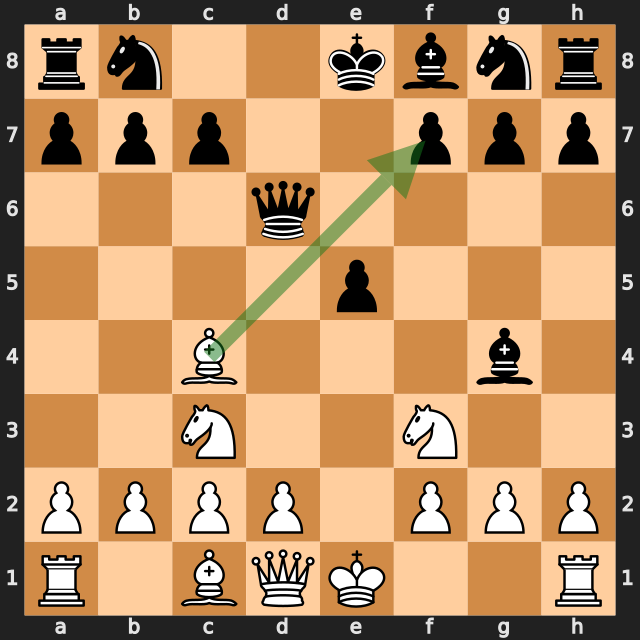
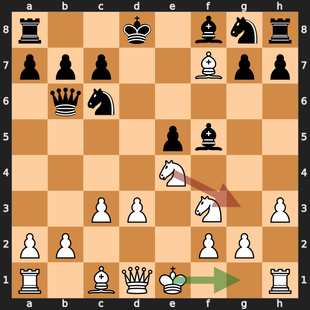
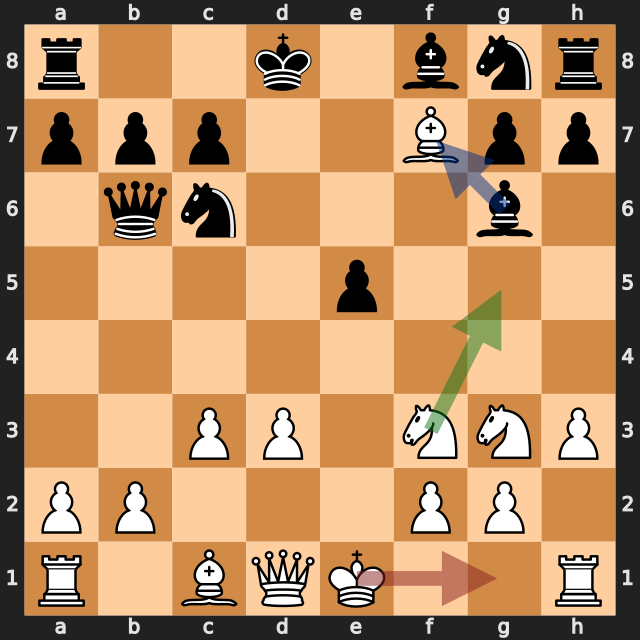
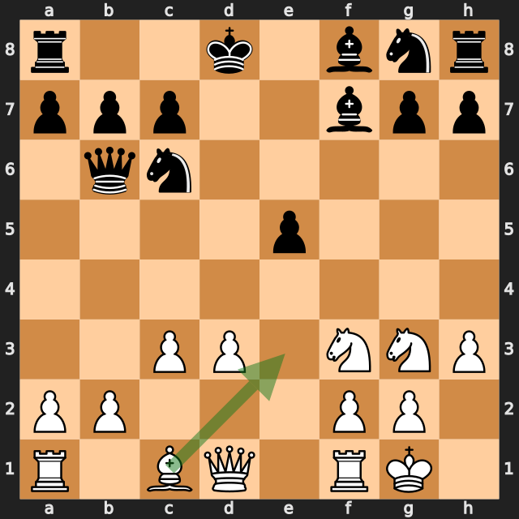

# 浮いたビショップと早すぎた投了——lichess、白番の振り返り

[棋譜（PGN）](game.pgn) · [全局面の解析](game.analysis.json) · [重要局面の再確認](verification.analysis.json) · [投了局面の解析](final-position.analysis.json) · [lichessの対局ページ](https://lichess.org/SC01LsIi)

2026年10月4日／lichess・レーティング戦（30分＋0秒）／白：筆者（1690）／黒：AntonioRaimundo（1599）／結果：0–1（12手で白の投了）

同じ相手との2局目です（1局目は[黒番で勝った対局](../2026-10-04-antonioraimundo/article.md)）。黒は **1.e4 e5 2.Nf3 d5** のエレファント・ギャンビットを選びました。白は **6.Bxf7+!** で黒の **5...Bg4?** をとがめ、11手目まで約 **+7** の大きな優勢でした。

ところが **12.O-O??** で、f7に入ったビショップが取られる形を見落としました。**12...Bxf7** の後、白は投了しています。ただし今回の探索では、投了した局面の評価は約 **+0.2** で、ほぼ互角でした。この一局の分かれ目は、12手目と投了の判断の2つです。

以下の評価値はすべて白視点で、プラスが白有利です。数値は今回の探索での目安で、確定的な勝率ではありません。局面図は白側から見た向きで、指す前の局面です。赤は実戦手、緑は検討候補、青は相手の駒の利きを表します。

評価が大きく動いた手を、最善候補との差で並べます（各6秒・MultiPV 4の再確認値）。

| 手 | 指した側 | 最善候補（評価） | 実戦（評価） | 差 |
|---|---|---|---|---|
| 5...Bg4 | 黒 | Be6（+1.11） | Bg4（+3.89） | 約2.8 |
| **6.Bxf7+** | 白（筆者） | Bxf7+（+3.39） | 同じ | 0 |
| 8.Ne4 | 白（筆者） | h3（+4.75） | Ne4（+3.42） | 約1.3 |
| 8...Qb4+ | 黒 | Qd7（+3.24） | Qb4+（+7.23） | 約4.0 |
| **12.O-O** | 白（筆者） | Ng5（+6.70） | O-O（+0.40） | **約6.3** |

## 1. 相手のミスをとがめた——6.Bxf7+!

**5...Bg4?** は約 **+3.89** で、黒の最善候補 **5...Be6**（約 +1.11）から大きく悪化した手でした。

白の **6.Bxf7+!** は最善候補と一致しています（約 **+3.39**）。参考変化は **6...Kxf7 7.Ng5+ Ke7 8.Qxg4** です。f3のナイトがg5へ跳ぶと、d1のクイーンからg4のビショップへの斜めが開き、しかもチェックなので黒はビショップを守る時間がありません（python-chessで確認）。白はビショップを取り返し、f7のポーンを1つ得ます。

実戦の黒は **6...Kd8** でビショップを取らず、約 **+4.81** になりました。

その後の **7.d3**・**8.Ne4** は、最善候補の **h3**（g4のビショップに当てる手、約 +4.7）より少し評価を下げましたが、黒の **8...Qb4+?**（約 +7.23）でさらに差が開いています。

**今回の良かった点：** 相手の駒が守られていないこと（g4のビショップ）に気づき、チェックを使って取る手順を見つけました。

## 2. ビショップの逃げ道を確認する——11.Ng3とf7のビショップ

6手目からずっと、白のビショップはf7にいます。11手目の時点で、このビショップを守る白の駒はありません。

**11.Ng3** はf5のビショップに当たる手で、黒は **11...Bg6** と引きました。このg6のビショップは、f7の白ビショップに当たります。最善候補の **11.O-O**（約 +7.63）との差は約0.9で、この手自体は大きな悪手ではありません。参考変化 **11...Bg6 12.Bxg6 hxg6** のように、次にビショップを交換すれば問題は起きませんでした。

## 3. 浮いたビショップを取られた——12.O-O??

最善候補は **12.Ng5**（約 **+6.70**）で、ナイトがf7のビショップを守ります（python-chessで確認）。**12.Bc4**（約 +6.63）で引く手や、**12.Bxg6**（約 +6.53）で交換する手も、ほぼ同じ評価でした。

実戦の **12.O-O??** は約 **+0.40** で、約6.3も悪化しました。f7のビショップは、g6の黒ビショップに当たったまま守りがなく、**12...Bxf7** と取られました。

**今回の学び：** 相手陣に入った駒は、毎手「守られているか」「逃げ道があるか」を確認する。相手の駒が自分の駒の近くに来たら、その駒が何に当たったかを見る。

## 4. 投了した局面は、ほぼ互角だった——12...Bxf7の後

**12...Bxf7** の後、白は投了しました。この局面を10秒・MultiPV 4で探索した結果は次のとおりです（[投了局面の解析](final-position.analysis.json)）。

| 白の候補 | 評価 | 探索で挙がった変化 |
|---|---|---|
| **13.Be3** | **+0.20** | 13...Qa6 14.b4 Nf6 15.a4 Nb8 16.Nxe5 |
| 13.b4 | 0.00 | 13...a5 14.Ng5 Nh6 15.Be3 Qa6 |
| 13.Ng5 | −0.28 | 13...Nh6 |
| 13.Re1 | −0.83 | 13...Nf6 14.Be3 Qb5 |

駒の数では、白がビショップ1枚少なく、ポーンは1つ多い形です（ポーン1、ナイト・ビショップ3、ルーク5、クイーン9で数えて白35、黒37）。それでも探索の評価はほぼ互角でした。黒キングはd8にいてキャスリングできず、白はキャスリングを終えています。ただし、評価が互角でも、人間どうしの対局で駒損の局面を指し続けるのは簡単ではありません。

前回の[jawher5241戦](../2026-09-25-jawher5241/article.md)でも、白は評価上まだ優勢な局面で投了していました。2局とも、悪手の直後に投了しています。

**今回の学び：** 悪手の直後こそ、投了の前に評価を落ち着いて見直す。持ち時間30分＋0秒の対局なので、少し時間を使って候補手を確認する。

## 次の対局で意識したいこと

- **相手陣に入った駒は、毎手守りを確認する。** 12.O-O??で、f7のビショップが取られました。
- **相手の駒の利きが変わったら、自分の駒に当たっていないか見る。** 11...Bg6でf7に当たりが生まれていました。
- **悪手の直後に投了しない。** 投了した局面は、評価の上ではほぼ互角でした。前回のjawher5241戦と合わせて2局目です。

---

解析：Stockfish 19、1スレッド、Hash 128MB。全局面0.3秒、候補12局面を各2秒・MultiPV 3で解析しました。記事で扱った局面（2...d5、5...Bg4、6.Bxf7+、6...Kd8、7.d3、8.Ne4、8...Qb4+、9.c3、10.h3、11.Ng3、12.O-O、12...Bxf7）は、各6秒・MultiPV 4で再確認しています。投了局面は10秒・MultiPV 4で探索しました。評価値は本文で明示した探索の値であり、確定的な勝率ではありません。

自動選定の重要局面（6局面：2...d5、3...Qxd5、4...Qd6、5.Bc4、5...Bg4、12.O-O）のうち、3...Qxd5・4...Qd6・5.Bc4は差が小さいため扱っていません。投了局面は自動選定の対象外のため、追加解析で確認しています。

このPGNにはlichessの評価コメントが付いておらず、数値はすべて本ツールのStockfishで計算しています。
