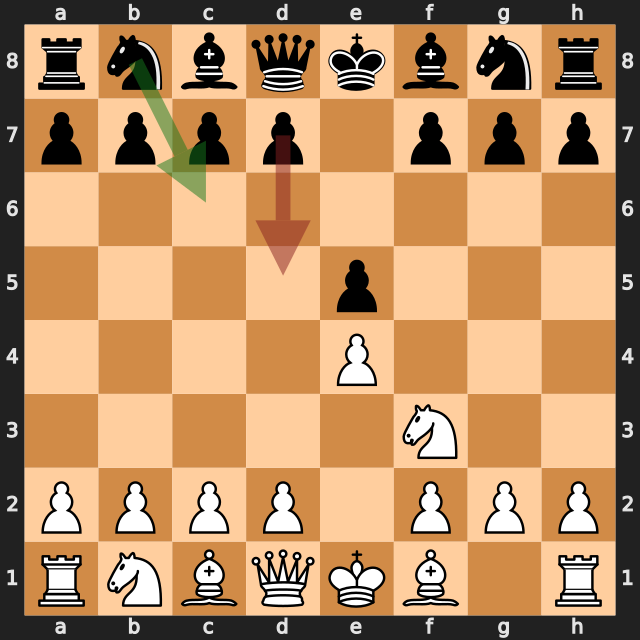
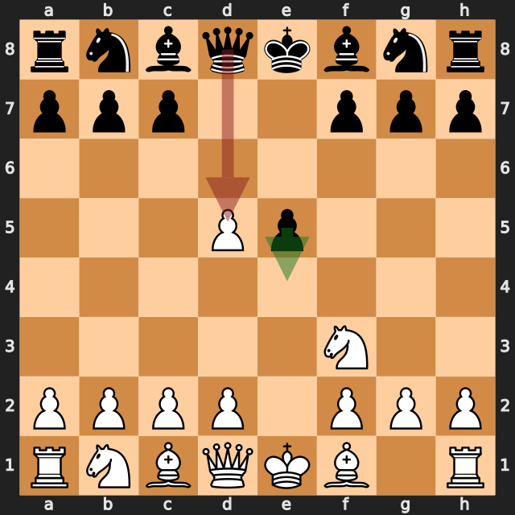
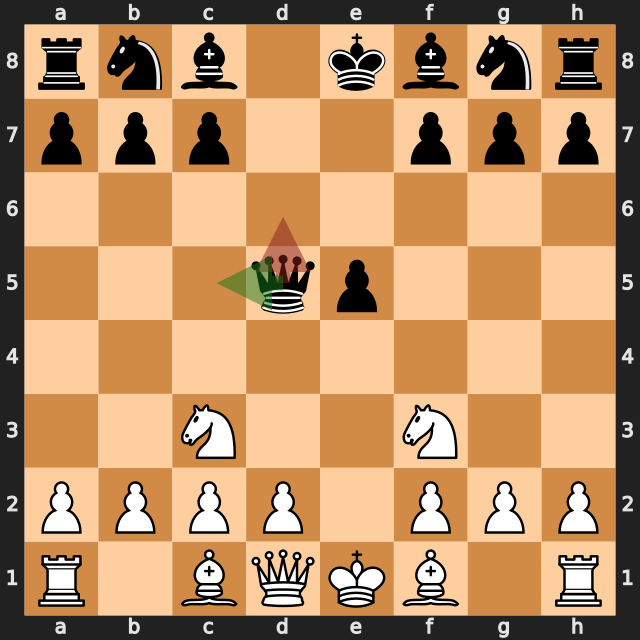
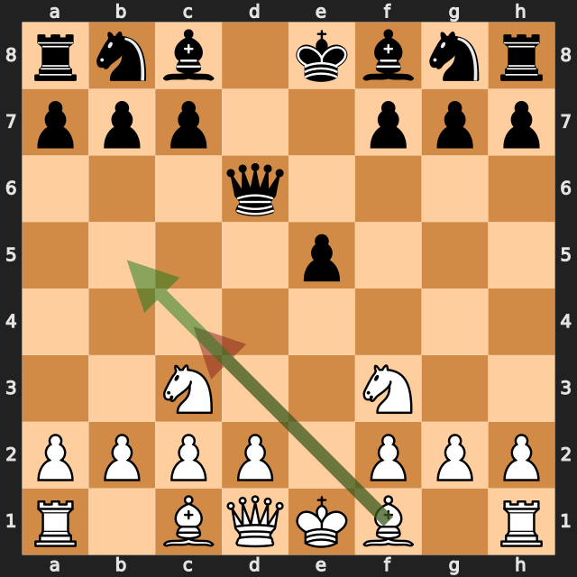
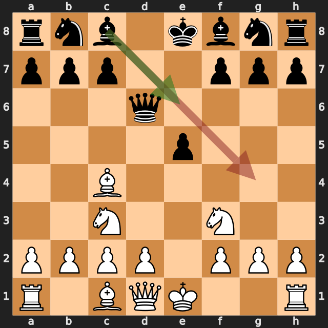
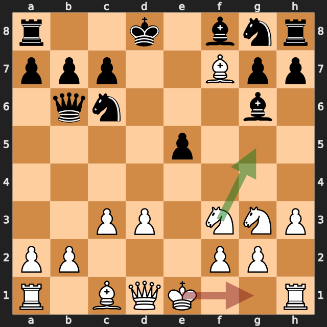

# zbxah vs AntonioRaimundo

結果: 0-1 / 日付: 2026.10.04

これはStockfishの計算結果に基づく解説下書きです。候補の選定と戦術・戦略の説明はAIアシスタントで仕上げます。

評価値は常に白視点（＋は白有利）。メイトは数値評価と分けて表示します。

「期待スコア」はsf16モデルによる勝ち＋引き分けの半分の推定値で、人間の勝率ではありません。分類は暫定です。

## 注目局面 2...d5

実戦は **d5**。推奨候補は **Nc6** です。

推奨候補の評価: +0.35 / 実戦手を選んだ場合: +1.05。

手番側の期待スコアの低下: 29.8ポイント。

推奨手からの参考変化: Nc6 → Bb5 → Nf6 → O-O → Nxe4 → Re1

実戦手からの参考変化: d5 → exd5

<!-- AIアシスタント: PVと盤面で裏付けられる狙い、相手の応手、改善点を説明する。未検証の戦術名や心理を創作しない。 -->

## 注目局面 3...Qxd5

実戦は **Qxd5**。推奨候補は **e4** です。

推奨候補の評価: +0.97 / 実戦手を選んだ場合: +1.34。

手番側の期待スコアの低下: 17.7ポイント。

推奨手からの参考変化: e4 → Qe2 → Nf6 → d3 → Qxd5 → Nbd2

実戦手からの参考変化: Qxd5 → Nc3

<!-- AIアシスタント: PVと盤面で裏付けられる狙い、相手の応手、改善点を説明する。未検証の戦術名や心理を創作しない。 -->

## 注目局面 4...Qd6

実戦は **Qd6**。推奨候補は **Qc5** です。

推奨候補の評価: +1.26 / 実戦手を選んだ場合: +1.33。

手番側の期待スコアの低下: 2.2ポイント。

推奨手からの参考変化: Qc5 → d4 → exd4 → Nxd4 → Nf6 → Qe2+

実戦手からの参考変化: Qd6 → d4 → exd4 → Nb5 → Qe7+ → Be2

<!-- AIアシスタント: PVと盤面で裏付けられる狙い、相手の応手、改善点を説明する。未検証の戦術名や心理を創作しない。 -->

## 注目局面 5.Bc4

実戦は **Bc4**。推奨候補は **Bb5+** です。

推奨候補の評価: +1.15 / 実戦手を選んだ場合: +0.98。

手番側の期待スコアの低下: 10.1ポイント。

推奨手からの参考変化: Bb5+ → c6

実戦手からの参考変化: Bc4 → Be6 → Nb5 → Qb6 → Bxe6 → fxe6

<!-- AIアシスタント: PVと盤面で裏付けられる狙い、相手の応手、改善点を説明する。未検証の戦術名や心理を創作しない。 -->

## 注目局面 5...Bg4

実戦は **Bg4**。推奨候補は **Be6** です。

推奨候補の評価: +1.17 / 実戦手を選んだ場合: +3.52。

手番側の期待スコアの低下: 11.7ポイント。

推奨手からの参考変化: Be6 → Nb5 → Qb6 → Bxe6 → fxe6 → Qe2

実戦手からの参考変化: Bg4 → Bxf7+ → Kxf7 → Ng5+ → Ke7 → Qxg4

<!-- AIアシスタント: PVと盤面で裏付けられる狙い、相手の応手、改善点を説明する。未検証の戦術名や心理を創作しない。 -->

## 注目局面 12.O-O

実戦は **O-O**。推奨候補は **Ng5** です。

推奨候補の評価: +6.43 / 実戦手を選んだ場合: +0.40。

手番側の期待スコアの低下: 47.8ポイント。

推奨手からの参考変化: Ng5 → Nh6 → Be6 → Ke8 → O-O → Be7

実戦手からの参考変化: O-O → Bxf7 → Be3 → Qxb2 → Ng5 → Nh6

<!-- AIアシスタント: PVと盤面で裏付けられる狙い、相手の応手、改善点を説明する。未検証の戦術名や心理を創作しない。 -->
