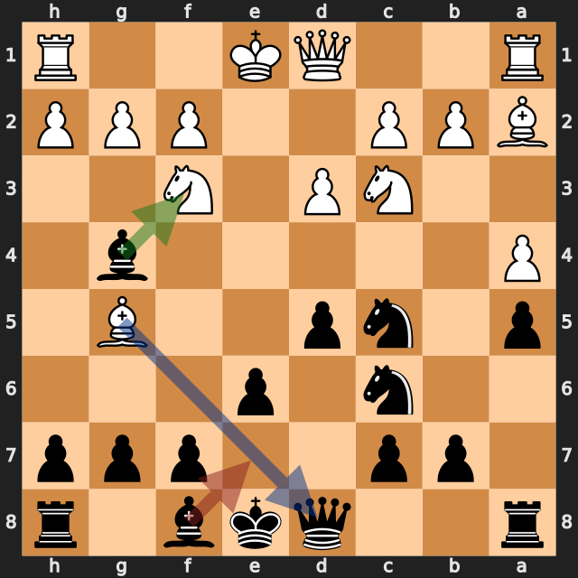
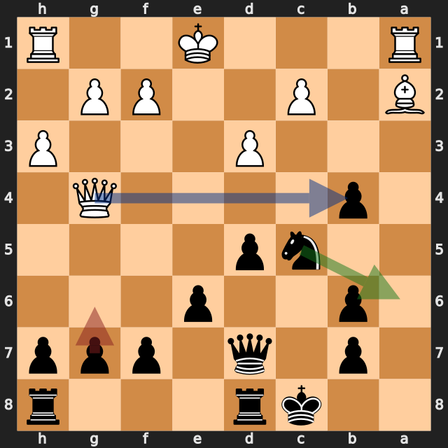
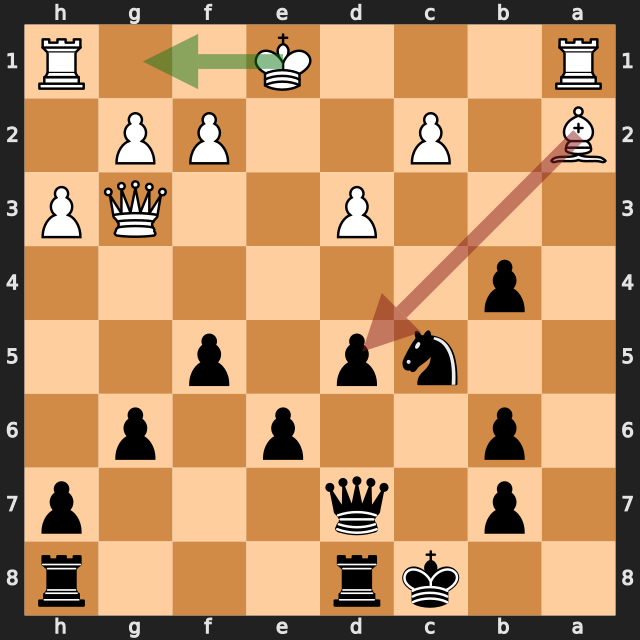

# 序盤のポーン得から押し切った一局——lichess、黒番の振り返り

[棋譜（PGN）](game.pgn) · [全局面の解析](game.analysis.json) · [重要局面の再確認](verification.analysis.json) · [lichessの対局ページ](https://lichess.org/ev8d14wr)

2026年10月4日／lichess・レーティング戦（30分＋0秒）／白：AntonioRaimundo（1603）／黒：筆者（1685）／結果：0–1（30手で白の投了）

**1.e4 Nf6 2.Nf3?** に対して、黒は **2...Nxe4** でポーンを取りました（lichessの分類は「Zukertort Opening: Lemberger Gambit」）。そのあと黒は一度も形勢を譲らず、白の **9.Bg5?** と **20.Bxd5?** で差が広がり、30手で白が投了しました。

勝った対局ですが、もっと早く決められた場面が2つあります。**9...Bxf3!** でビショップを1枚得る手と、**18...Na6** でb4を守る手です。

以下の評価値はすべて白視点です。プラスが白有利、マイナスが黒（筆者）有利です。数値は今回の探索での目安で、確定的な勝率ではありません。局面図は黒側から見た向きで、指す前の局面です。赤は実戦手、緑は検討候補、青は相手の駒の利きを表します。

評価が大きく動いた手を、最善候補との差で並べます（各6秒・MultiPV 4の再確認値）。

| 手 | 指した側 | 最善候補（評価） | 実戦（評価） | 差 |
|---|---|---|---|---|
| 2.Nf3 | 白 | e5（+0.79） | Nf3（−0.80） | 約1.6 |
| 9.Bg5 | 白 | d4（−2.35） | Bg5（−8.13） | 約5.8 |
| **9...Be7** | 黒（筆者） | Bxf3（−8.12） | Be7（−3.64） | **約4.5** |
| **18...g6** | 黒（筆者） | Na6（−3.85） | g6（−2.00） | **約1.9** |
| 19.Qg3 | 白 | Qxb4（−1.89） | Qg3（−4.75） | 約2.9 |
| 20.Bxd5 | 白 | O-O（−3.84） | Bxd5（−7.52） | 約3.7 |

## 1. 序盤のポーン得——2...Nxe4

**1.e4 Nf6** のあと、白の最善候補は **2.e5**（約 +0.79）でした。実戦の **2.Nf3?** はe4のポーンを守らない手で、約 **−0.80** です。黒の **2...Nxe4** は最善候補と一致しており、ここで黒がポーンを得ました。

その後も黒は大きく崩れず、8手目のあとは約 **−2.3** まで差を広げています。

## 2. ビショップを得るチャンス——9...Be7（9...Bxf3!なら約−8）

**9.Bg5?** は、d8のクイーンに当たる手です（python-chessで確認）。最善候補の **9.d4**（約 −2.35）に対して約 **−8.13** で、白の大きなミスでした。

最善候補は **9...Bxf3!**（約 **−8.12**）です。f3のナイトを取ると、黒のビショップがd1の白クイーンに当たります。お互いのクイーンが当たり合う形ですが、黒が先にナイトを取っている分、駒得が残ります。この局面を6秒・MultiPV 4で追加の探索をした結果は次のとおりです（ファイルには保存していません）。

| 白の応手 | 評価 | 探索で挙がった変化 |
|---|---|---|
| 10.Qd2 | −7.67 | 10...f6 11.Bf4 g5 12.O-O gxf4 |
| 10.Qxf3 | −8.27 | 10...Qxg5 |
| 10.Bxd8 | −8.59 | 10...Bxd1 11.Bxc7 Bxc2 |

どの応手でも、黒が駒を1枚多く持つ形です。

実戦の **9...Be7** は約 **−3.64** で、クイーンへの当たりを防ぐ手としては自然です。それでも黒の優勢は続きました。

**今回の学び：** クイーンに当たりを受けたら、逃げる・防ぐ前に、相手のクイーンに当てながら取る手がないかを探す。

## 3. b4の守りを見落とした——18...g6

13...O-O-O、14...Nxb5で差は少し縮みましたが、17手目のあとも約 **−3.3** で黒が優勢でした。

**18.Qg4** の白クイーンは、g7とb4の2つのポーンに当たっています。どちらも守る黒の駒はありません（python-chessで確認）。実戦の **18...g6** はg7を守りましたが、b4は取られる形のまま残り、約 **−2.00** になりました。

最善候補は **18...Na6**（約 **−3.85**）です。ナイトがb4を守ります。g7は守っていませんが、追加の探索では **19.Qxg7 Rhg8** と進むと、黒のルークがg2に当たる形で、約 **−4.76** と黒がさらに良くなりました。

実戦の白は **19.Qxb4**（約 −1.89）を指さず、**19.Qg3?**（約 −4.75）と引いたので、黒の優勢が戻りました。

**今回の学び：** 相手のクイーンが出てきたら、当たっている駒をすべて数える。2つ同時に当たっているときは、1つを守るだけでなく、両方の守りを考える。

## 4. 勝負を決めた白のミス——20.Bxd5?

d5のポーンには、白はa2のビショップしか当たっていません。黒はe6のポーンとd7のクイーンで守っています（python-chessで確認）。**20.Bxd5?** は約 **−7.52** で、**20...Qxd5** とビショップを取られました。白の最善候補は **20.O-O**（約 −3.84）でした。

ここからの黒は、ビショップ1枚分の差を保って進めました。**24...Qxd4+**、**26...gxh4**、**27...Qxd1+** と駒をさばき、30手目の時点で黒の駒は白より7点分多くなりました（ポーン1、ナイト・ビショップ3、ルーク5、クイーン9で数えて黒15、白8）。

終盤の **28...Ke7**（最善候補 Kc6 との差約1.9）と **30...Rg8**（最善候補 Rd8 との差約6.6）も、最善候補とは差がありましたが、どちらも黒の勝勢（約 −8 以下）の中での差です。

## 次の対局で意識したいこと

- **当たりを受けたら、相手のクイーンに当て返す手を探す。** 9...Bxf3!で、ビショップを1枚得られました。
- **相手のクイーンが当たっている駒を、すべて数える。** 18...g6はg7を守りましたが、b4が残りました。
- **相手のミスを、そのまま結果につなげた。** 2.Nf3?と20.Bxd5?を確実にとがめ、勝ち切りました。

---

解析：Stockfish 19、1スレッド、Hash 128MB。全局面0.3秒、候補12局面を各2秒・MultiPV 3で解析しました。記事で扱った局面（2.Nf3、9.Bg5、9...Be7、11...Bxf3、13...O-O-O、14...Nxb5、18...g6、19.Qg3、19...f5、20.Bxd5、21...Kd7、28...Ke7、30...Rg8）は、各6秒・MultiPV 4で再確認しています。9...Bxf3の後の白の応手と、18...Na6・19.Qxg7の局面は、別に6秒で確認しました（ファイルには保存していません）。評価値は本文で明示した探索の値であり、確定的な勝率ではありません。

自動選定の重要局面（6局面：1...Nf6、2.Nf3、3.Bc4、4.Bb3、4...a5、5.a4）は序盤の手が中心で、9.Bg5以降は入りませんでした。0.3秒の軽量解析では、9.Bg5の直後が約−7.75と出ていたため、追加解析で確認しています。

このPGNにはlichessの評価コメントが付いておらず、数値はすべて本ツールのStockfishで計算しています。
