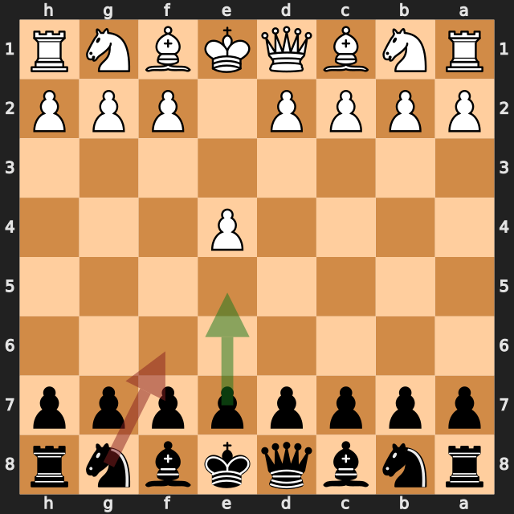
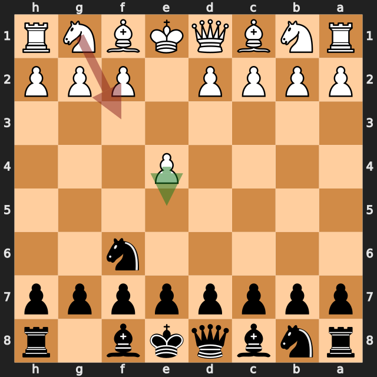
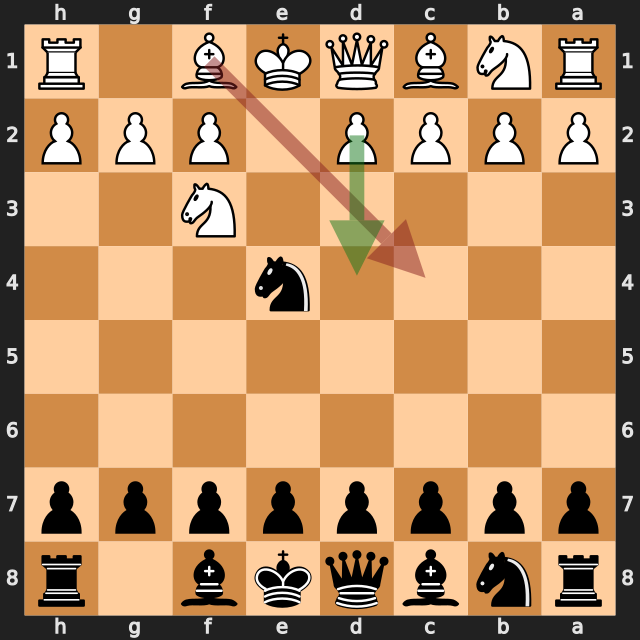
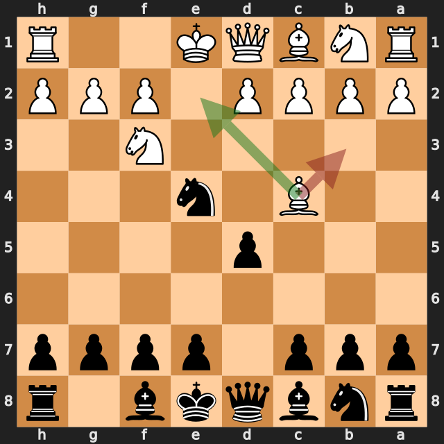
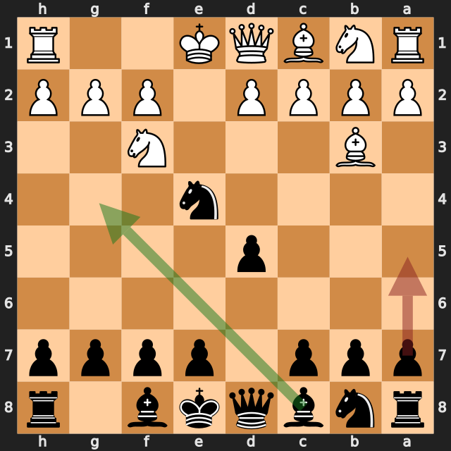
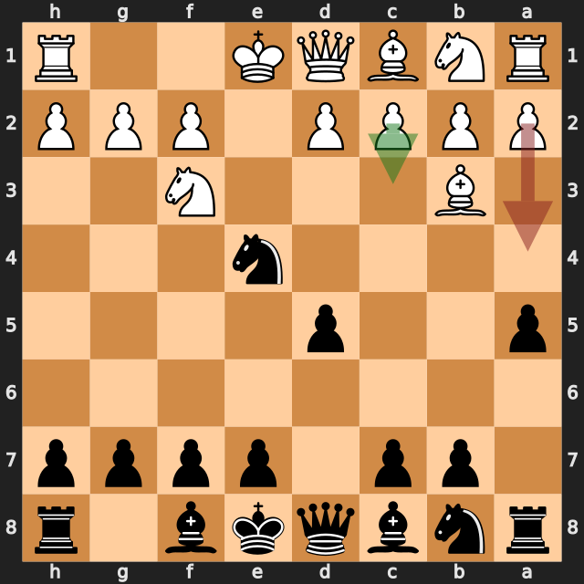

# AntonioRaimundo vs zbxah

結果: 0-1 / 日付: 2026.10.04

これはStockfishの計算結果に基づく解説下書きです。候補の選定と戦術・戦略の説明はAIアシスタントで仕上げます。

評価値は常に白視点（＋は白有利）。メイトは数値評価と分けて表示します。

「期待スコア」はsf16モデルによる勝ち＋引き分けの半分の推定値で、人間の勝率ではありません。分類は暫定です。

## 注目局面 1...Nf6

実戦は **Nf6**。推奨候補は **e5** です。

推奨候補の評価: +0.25 / 実戦手を選んだ場合: +0.78。

手番側の期待スコアの低下: 14.1ポイント。

推奨手からの参考変化: e5 → Nf3 → Nc6 → Bb5 → Nf6 → O-O

実戦手からの参考変化: Nf6 → e5

<!-- AIアシスタント: PVと盤面で裏付けられる狙い、相手の応手、改善点を説明する。未検証の戦術名や心理を創作しない。 -->

## 注目局面 2.Nf3

実戦は **Nf3**。推奨候補は **e5** です。

推奨候補の評価: +0.62 / 実戦手を選んだ場合: -0.87。

手番側の期待スコアの低下: 28.5ポイント。

推奨手からの参考変化: e5 → Nd5 → c4 → Nb6 → Nc3 → d6

実戦手からの参考変化: Nf3 → Nxe4 → d4 → g6 → Bd3 → Nf6

<!-- AIアシスタント: PVと盤面で裏付けられる狙い、相手の応手、改善点を説明する。未検証の戦術名や心理を創作しない。 -->

## 注目局面 3.Bc4

実戦は **Bc4**。推奨候補は **d4** です。

推奨候補の評価: -0.71 / 実戦手を選んだ場合: -1.54。

手番側の期待スコアの低下: 36.4ポイント。

第2候補との評価差が大きく、最善候補を見つけることが重要な局面です。唯一手かどうかは追加検証が必要です。

推奨手からの参考変化: d4 → g6 → Bd3 → Nf6 → c4 → Bg7

実戦手からの参考変化: Bc4 → d5 → Be2 → g6 → d3 → Nd6

<!-- AIアシスタント: PVと盤面で裏付けられる狙い、相手の応手、改善点を説明する。未検証の戦術名や心理を創作しない。 -->

## 注目局面 4.Bb3

実戦は **Bb3**。推奨候補は **Be2** です。

推奨候補の評価: -1.66 / 実戦手を選んだ場合: -1.92。

手番側の期待スコアの低下: 0.8ポイント。

推奨手からの参考変化: Be2 → c5

実戦手からの参考変化: Bb3 → Bg4 → d4 → e6 → h3 → Bxf3

<!-- AIアシスタント: PVと盤面で裏付けられる狙い、相手の応手、改善点を説明する。未検証の戦術名や心理を創作しない。 -->

## 注目局面 4...a5

実戦は **a5**。推奨候補は **Bg4** です。

推奨候補の評価: -2.01 / 実戦手を選んだ場合: -1.80。

手番側の期待スコアの低下: 0.4ポイント。

推奨手からの参考変化: Bg4 → d4 → e6 → h3 → Bh5 → Nbd2

実戦手からの参考変化: a5 → c3 → Bg4 → h3 → Bh5 → d3

<!-- AIアシスタント: PVと盤面で裏付けられる狙い、相手の応手、改善点を説明する。未検証の戦術名や心理を創作しない。 -->

## 注目局面 5.a4

実戦は **a4**。推奨候補は **c3** です。

推奨候補の評価: -1.80 / 実戦手を選んだ場合: -2.30。

手番側の期待スコアの低下: 0.5ポイント。

推奨手からの参考変化: c3 → Bg4 → d3 → Nf6 → h3 → Bh5

実戦手からの参考変化: a4 → Bg4 → d4 → e6 → Nbd2 → Nxd2

<!-- AIアシスタント: PVと盤面で裏付けられる狙い、相手の応手、改善点を説明する。未検証の戦術名や心理を創作しない。 -->
