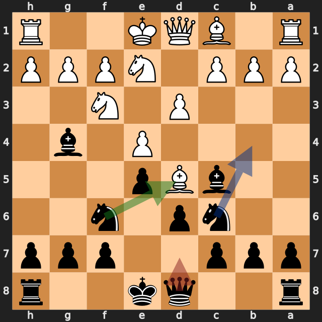
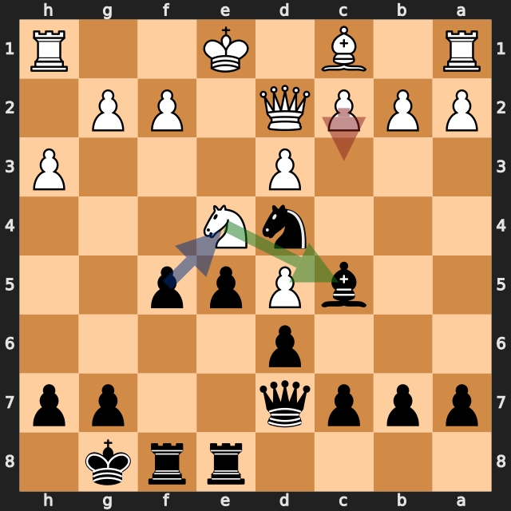

# f列のポーンがクイーンになった一局——lichess、黒番の振り返り

[棋譜（PGN）](game.pgn) · [全局面の解析](game.analysis.json) · [重要局面の再確認](verification.analysis.json) · [lichessの対局ページ](https://lichess.org/PlQuxPxC)

2026年10月7日／lichess・レーティング戦（30分＋20秒）／白：Flordog（1623）／黒：筆者（1682）／結果：0–1（28手で白の投了）

ビショップス・オープニング（lichessの分類は「Vienna Hybrid, Spielmann Attack」）から始まった一局です。序盤に **7...Nxd5** でポーンを得るチャンスを2回見送りましたが、白の **13.Ne4?** に **13...f5!** と当て、**14.c3?** の後に大きな優勢をつかみました。そこからは、f列から取り込んだポーンがe列・d列と進み、**22...dxc1=Q** でクイーンになって勝ち切りました。

以下の評価値はすべて白視点です。プラスが白有利、マイナスが黒（筆者）有利です。数値は今回の探索での目安で、確定的な勝率ではありません。局面図は黒側から見た向きで、指す前の局面です。赤は実戦手、緑は検討候補、青は補足の利き筋や狙いを表します。

評価が大きく動いた手を、最善候補との差で並べます（各6秒・MultiPV 4の再確認値）。

| 手 | 指した側 | 最善候補（評価） | 実戦（評価） | 差 |
|---|---|---|---|---|
| 7.Ne2 | 白 | Bxc6+（−0.04） | Ne2（−1.97） | 約1.9 |
| **7...Qd7** | 黒（筆者） | Nxd5（−1.80） | Qd7（−0.61） | **約1.2** |
| 8.Ng5 | 白 | Bxc6（−0.55） | Ng5（−1.84） | 約1.3 |
| **8...O-O** | 黒（筆者） | Nxd5（−1.54） | O-O（−0.70） | **約0.8** |
| 13.Ne4 | 白 | c3（−1.18） | Ne4（−3.04） | 約1.9 |
| 14.c3 | 白 | Nxc5（−2.75） | c3（−7.21） | 約4.5 |
| **22...dxc1=Q** | 黒（筆者） | d1=Q+（黒のメイト） | dxc1=Q（−10.31） | — |

## 1. 2回見送ったポーン得——7...Qd7と8...O-O

白の **6.Bd5** のビショップは、c3のナイトとe4のポーンに守られていました。**7.Ne2** でナイトがc3から離れたため、d5のビショップを守るのはe4のポーンだけになりました（python-chessで確認）。

最善候補は **7...Nxd5**（約 **−1.80**）です。**8.exd5** と取り返されると、d5に白のポーンが残ります。7.Ne2の詳細解析では、**7...Nxd5 8.exd5 Nb4** と進み、b4のナイトがd5とc2に当たる変化が挙がりました。この時点でd5のポーンを守る白の駒はなく（python-chessで確認）、変化の先では黒がd5のポーンを取っています。

実戦の **7...Qd7** は約 **−0.61** です。次の **8.Ng5** の後も、最善候補は同じ **8...Nxd5**（約 **−1.54**）でしたが、実戦は **8...O-O**（約 −0.70）でした。

**今回の学び：** 相手の駒が動いたら、その駒が守っていたものを確認する。今回はNe2で、d5のビショップの守りが1つ減りました。

## 2. 当てた手と、相手の見落とし——13...f5!と14.c3?

**13.Ne4?**（約 −3.04）に対して、黒の **13...f5!** はナイトに当てる手です。最善候補の **13...Bb6**（約 −3.07）とほぼ同じ評価でした。

e4のナイトは、d3のポーンに守られていますが、f5のポーンに当たっています（python-chessで確認）。白の最善候補は **14.Nxc5**（約 −2.75）で、ナイトを動かしながらc5のビショップと交換する手でした。

実戦の **14.c3?** はd4のナイトに当て返す手でしたが、約 **−7.21** に悪化しました。**14...fxe4 15.cxd4 Bxd4** で、お互いにナイトを取り合いましたが、黒のポーンがe4まで進んでいます。

**今回の良かった点：** 相手のナイトが中央に出てきたとき、ポーンで当てて主導権を取りました。

## 3. ポーンが進んだ先で——22...dxc1=Q

14...fxe4で取り込んだポーンは、**17...exd3**、**21...d2+** と進みました。e5のポーンも **18...e4**、**20...e3** と続いています。白キングの前に、2つのポーンが並びました。

ここでの最善候補は **22...d1=Q+**（黒のメイト、エンジン表記 #-9）です。参考変化は **22...d1=Q+ 23.Kxd1 e2+ 24.Kc2 exf1=Q** で、クイーンを捨てた後、e2のポーンがチェックしながらf1のルークに当たり、もう一度クイーンになります（python-chessで確認）。

実戦の **22...dxc1=Q** は約 **−10.31** で、ビショップを取ってクイーンになりました。**23.Raxc1** の後も、黒は駒の点数で5点多く（ポーン1、ナイト・ビショップ3、ルーク5、クイーン9で数えて黒29、白24）、勝勢は変わりません。前の手の **21...d2+** も、最善候補の **21...e2**（エンジン表記 #-7）より長い手順でしたが、どちらも黒のメイトの評価でした。

勝勢の局面での差なので、大きな問題ではありません。ただ、ポーンが2つ並んだ形では、**チェックしながら成る手** から先に読むと、より速く決まることがあります。

## 4. 終局

その後、黒は **25...Qe5**、**27...Qg3** とクイーンを白キングに近づけ、**28...Qf2+** で白が投了しました。この局面の評価は、黒のメイト（エンジン表記 #-9）です。

23...c5（最善候補 Kh8 との差約1.5）と24...a6（最善候補 Qe5 との差約3.2）は、最善候補とは差がありましたが、どちらも約 −8 以下の黒の勝勢の中での差です。

## 次の対局で意識したいこと

- **相手の駒が動いたら、その駒が守っていたものを確認する。** 7.Ne2の後、7...Nxd5でポーンを得るチャンスがありました。
- **中央に出てきた相手のナイトには、ポーンで当てる。** 13...f5!が、14.c3?のミスを引き出しました。
- **ポーンが成れる局面では、チェックしながら成る手から読む。** 22...d1=Q+のほうが速く決まりました。

---

解析：Stockfish 19、1スレッド、Hash 128MB。全局面0.3秒、候補12局面を各2秒・MultiPV 3で解析しました。記事で扱った局面（7.Ne2、7...Qd7、8.Ng5、8...O-O、12...Rae8、13.Ne4、13...f5、14.c3、21...d2+、22...dxc1=Q、23...c5、24...a6）は、各6秒・MultiPV 4で再確認しています。評価値は本文で明示した探索の値であり、確定的な勝率ではありません。

自動選定の重要局面（6局面：7.Ne2、7...Qd7、8.Ng5、8...O-O、9.h3、22...dxc1=Q）のうち、9.h3は差が小さいため扱っていません。13.Ne4と14.c3は自動選定に入りませんでしたが、勝敗の転換点のため追加解析で確認しています。12...Rae8（最善候補 h6 との差約0.7）も確認しましたが、本文の主題から外れるため扱っていません。

このPGNにはlichessの評価コメントが付いておらず、数値はすべて本ツールのStockfishで計算しています。
