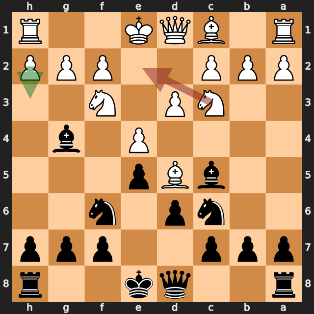
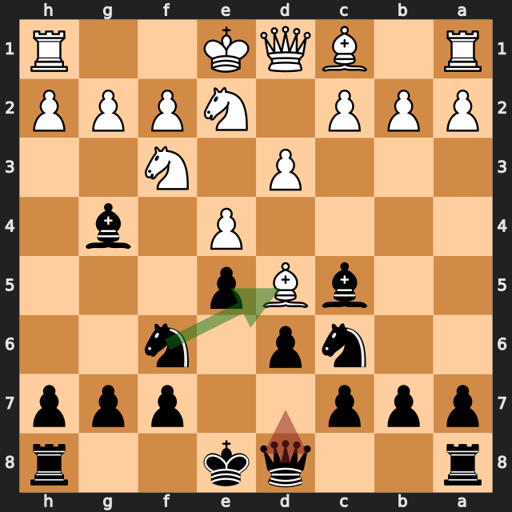
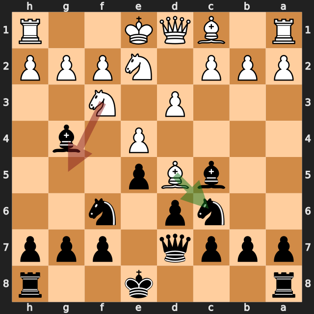
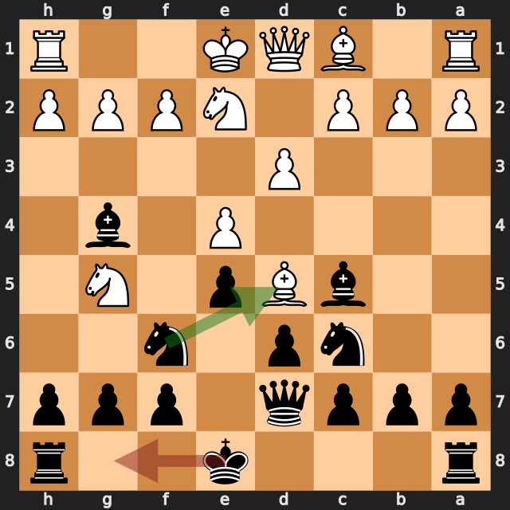
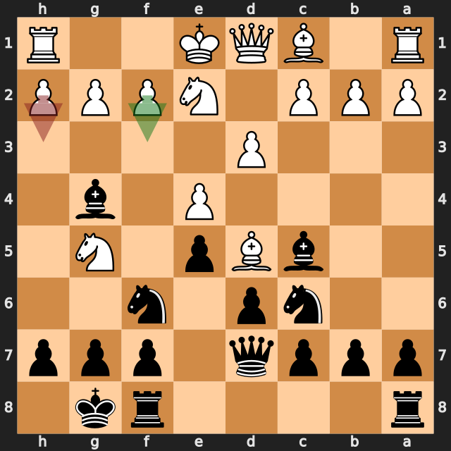
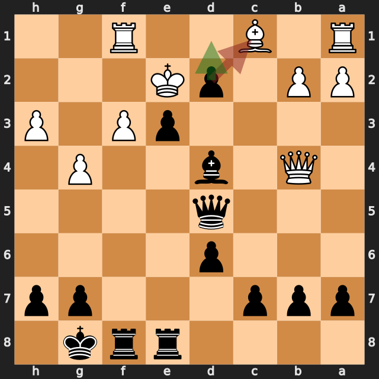

# Flordog vs zbxah

結果: 0-1 / 日付: 2026.10.07

これはStockfishの計算結果に基づく解説下書きです。候補の選定と戦術・戦略の説明はAIアシスタントで仕上げます。

評価値は常に白視点（＋は白有利）。メイトは数値評価と分けて表示します。

「期待スコア」はsf16モデルによる勝ち＋引き分けの半分の推定値で、人間の勝率ではありません。分類は暫定です。

## 注目局面 7.Ne2

実戦は **Ne2**。推奨候補は **h3** です。

推奨候補の評価: -0.20 / 実戦手を選んだ場合: -2.08。

手番側の期待スコアの低下: 49.1ポイント。

推奨手からの参考変化: h3 → Nxd5

実戦手からの参考変化: Ne2 → Nxd5 → exd5 → Nb4 → c3 → Nxd5

<!-- AIアシスタント: PVと盤面で裏付けられる狙い、相手の応手、改善点を説明する。未検証の戦術名や心理を創作しない。 -->

## 注目局面 7...Qd7

実戦は **Qd7**。推奨候補は **Nxd5** です。

推奨候補の評価: -2.14 / 実戦手を選んだ場合: -0.58。

手番側の期待スコアの低下: 43.9ポイント。

第2候補との評価差が大きく、最善候補を見つけることが重要な局面です。唯一手かどうかは追加検証が必要です。

推奨手からの参考変化: Nxd5 → exd5 → Nb4 → Nc3 → Bd4 → Ne4

実戦手からの参考変化: Qd7 → Bxc6

<!-- AIアシスタント: PVと盤面で裏付けられる狙い、相手の応手、改善点を説明する。未検証の戦術名や心理を創作しない。 -->

## 注目局面 8.Ng5

実戦は **Ng5**。推奨候補は **Bxc6** です。

推奨候補の評価: -0.66 / 実戦手を選んだ場合: -2.08。

手番側の期待スコアの低下: 41.3ポイント。

第2候補との評価差が大きく、最善候補を見つけることが重要な局面です。唯一手かどうかは追加検証が必要です。

推奨手からの参考変化: Bxc6 → Qxc6 → c4 → Bxf3 → gxf3 → Qd7

実戦手からの参考変化: Ng5 → Nxd5 → exd5 → Ne7 → h3 → Bxe2

<!-- AIアシスタント: PVと盤面で裏付けられる狙い、相手の応手、改善点を説明する。未検証の戦術名や心理を創作しない。 -->

## 注目局面 8...O-O

実戦は **O-O**。推奨候補は **Nxd5** です。

推奨候補の評価: -1.99 / 実戦手を選んだ場合: -0.83。

手番側の期待スコアの低下: 32.8ポイント。

推奨手からの参考変化: Nxd5 → exd5 → Ne7 → c4 → c6 → dxc6

実戦手からの参考変化: O-O → f3 → Bh5 → h4 → a5 → a3

<!-- AIアシスタント: PVと盤面で裏付けられる狙い、相手の応手、改善点を説明する。未検証の戦術名や心理を創作しない。 -->

## 注目局面 9.h3

実戦は **h3**。推奨候補は **f3** です。

推奨候補の評価: -0.99 / 実戦手を選んだ場合: -1.64。

手番側の期待スコアの低下: 21.4ポイント。

推奨手からの参考変化: f3 → Bh5 → h4 → a5 → a3 → Nxd5

実戦手からの参考変化: h3 → Bxe2 → Qxe2 → Nd4 → Qd1 → h6

<!-- AIアシスタント: PVと盤面で裏付けられる狙い、相手の応手、改善点を説明する。未検証の戦術名や心理を創作しない。 -->

## 注目局面 22...dxc1=Q

実戦は **dxc1=Q**。推奨候補は **d1=Q+** です。

推奨候補の評価: 黒のメイト（エンジン表記 #-9） / 実戦手を選んだ場合: -10.43。

手番側の期待スコアの低下: 0.0ポイント。

推奨手ではメイトが示されていますが、実戦手ではそのメイトが確認できなくなりました。

推奨手からの参考変化: d1=Q+ → Kxd1 → e2+ → Kc2 → exf1=Q → Bd2

実戦手からの参考変化: dxc1=Q → Raxc1 → Qe5 → Rxc7 → d5 → Rxb7

<!-- AIアシスタント: PVと盤面で裏付けられる狙い、相手の応手、改善点を説明する。未検証の戦術名や心理を創作しない。 -->
