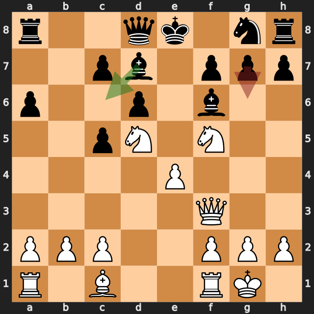
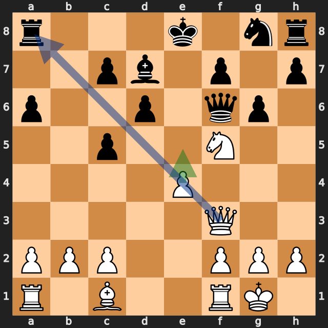

# ポーン1つで開いた斜め——lichess、白番の振り返り（通信戦）

[棋譜（PGN）](game.pgn) · [全局面の解析](game.analysis.json) · [重要局面の再確認](verification.analysis.json) · [lichessの対局ページ](https://lichess.org/0SvDMFak)

2026年10月11日開始／lichess・レーティング戦（通信戦、1手1日）／白：筆者（2153）／黒：delegator773（2021）／結果：1–0（18手で黒の投了）

ルイ・ロペスのスタイニッツ・ディフェンス（**3...d6**）から始まった通信戦です。白は序盤から最善候補と一致する手を続け、黒の **11...g6?** の後、**12.Nxf6+ Qxf6 13.e5!** でa8のルークを取りました。18手で黒が投了しています。

レーティングは通信戦のもので、これまでの記事のクラシカル（30分）のレーティングとは別です。

以下の評価値はすべて白視点で、プラスが白（筆者）有利です。数値は今回の探索での目安で、確定的な勝率ではありません。局面図は白側から見た向きで、指す前の局面です。赤は実戦手、緑は検討候補、青は狙いの利き筋を表します。

評価が大きく動いた手を、最善候補との差で並べます（各6秒・MultiPV 4の再確認値）。

| 手 | 指した側 | 最善候補（評価） | 実戦（評価） | 差 |
|---|---|---|---|---|
| **9.Qf3** | 白（筆者） | Qf3（+1.44） | 同じ | 0 |
| **10.Nf5** | 白（筆者） | Nf5（+1.44） | 同じ | 0 |
| **11.Nd5** | 白（筆者） | Nd5（+1.81） | 同じ | 0 |
| 11...g6 | 黒 | Bc6（+1.80） | g6（+7.42） | 約5.6 |
| **12.Nxf6+** | 白（筆者） | Nh6（+7.77） | Nxf6+（+7.15） | **約0.6** |
| **13.e5** | 白（筆者） | e5（+6.80） | 同じ | 0 |
| **17.Qxa6** | 白（筆者） | Qf8（+9.07） | Qxa6（+7.78） | **約1.3** |

## 1. 序盤から中盤——最善候補が続いた

**7.Bxc6 bxc6** で黒のポーンの形を崩した後、**9.Qf3**、**10.Nf5**、**11.Nd5** はいずれも最善候補と一致しました。11手目のあとは約 **+1.8** で、白がはっきり優勢です。

**10.Nf5** のナイトは、d7のビショップに取られる位置にあります。10.Nf5の詳細解析では **10...Bxf5 11.exf5** と取り合う変化が挙がっており、取られても白の優勢（約 +1.44）は変わりませんでした。

## 2. 相手のミス——11...g6?

**11.Nd5** は、f6のビショップに当たる手です。この時点のf6のビショップは、g7のポーン、d8のクイーン、g8のナイトに守られていました（python-chessで確認）。

黒の最善候補は **11...Bc6**（約 +1.80）で、d5のナイトに当て返す手でした。実戦の **11...g6?** はf5のナイトに当てる手ですが、約 **+7.42** に悪化しました。g7のポーンが動いたため、f6のビショップの守りが1つ減っています。

## 3. 斜めを開けたポーン——13.e5!

**12.Nxf6+ Qxf6** の後、最善候補と一致したのが **13.e5!**（約 **+6.80**）です。

この手には2つの働きがあります（python-chessで確認）。

- e5のポーンが、f6のクイーンとd6のポーンに当たる
- e4のポーンがいなくなり、f3の白クイーンからa8のルークへの斜めが開く

黒は **13...Qxf5** でf5のナイトを取りましたが、**14.Qxa8+** でルークを取られました。**13...Qd8**（約 +7.38）でクイーンを引いても、評価はほぼ同じでした。

12手目の最善候補は **12.Nh6**（約 +7.77）でしたが、実戦の **12.Nxf6+**（約 +7.15）との差は約0.6で、どちらも白の勝勢です。

**今回の良かった点：** ポーンを1つ進めて、相手のクイーンへの当たりと、自分のクイーンの斜めを同時に作りました。

## 4. 終盤の仕上げ

**15.exd6+ cxd6 16.Re1+** と、チェックを続けて黒キングをf6まで引き出しました。**17.Qxa6** は最善候補の **17.Qf8**（約 +9.07）より約1.3低い評価でしたが、約 **+7.78** の勝勢です。**18.c4** の後、黒が投了しました。

## 次の対局で意識したいこと

- **ポーンを動かして、自分の駒の利きを通す手を探す。** 13.e5!で、f3のクイーンからa8への斜めが開きました。
- **勝勢でも、より強い手を確認する。** 17.Qf8のほうが評価の高い手でした。通信戦は時間に余裕があるので、候補手を比べる習慣をつけやすい対局です。

---

解析：Stockfish 19、1スレッド、Hash 128MB。全局面0.3秒、候補12局面を各2秒・MultiPV 3で解析しました。記事で扱った局面（9.Qf3、10.Nf5、11.Nd5、11...g6、12.Nxf6+、13.e5、13...Qxf5、14.Qxa8+、17.Qxa6、18.c4）は、各6秒・MultiPV 4で再確認しています。評価値は本文で明示した探索の値であり、確定的な勝率ではありません。

自動選定の重要局面（6局面：3...d6、6...a6、8...Be7、9...c5、10...Bf6、11...g6）は、ほとんどが黒の手で差が小さいため、11...g6以外は扱っていません。

このPGNにはlichessの評価コメントが付いておらず、数値はすべて本ツールのStockfishで計算しています。
