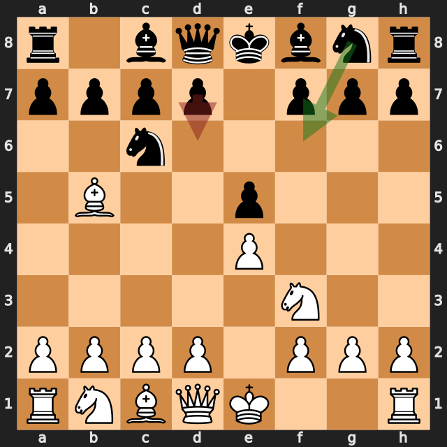
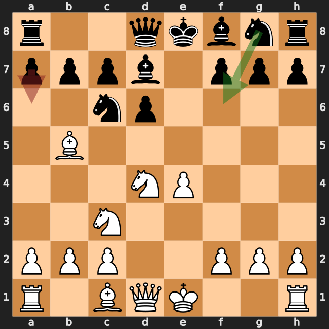
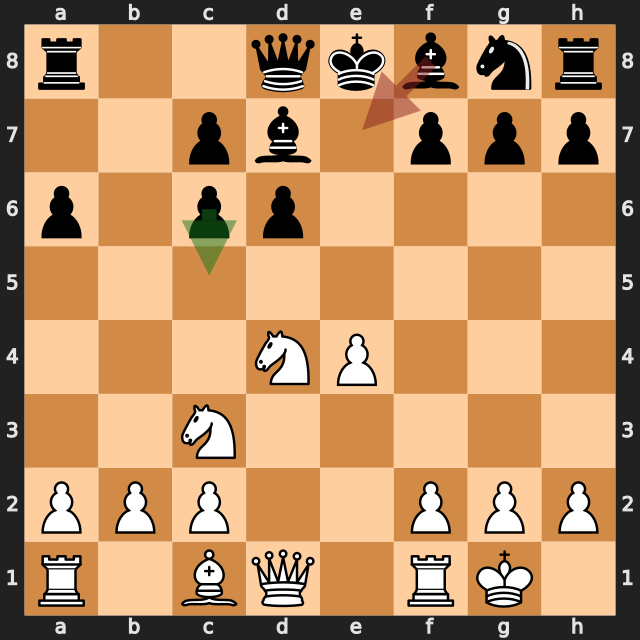
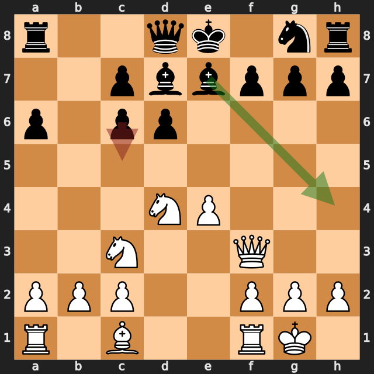
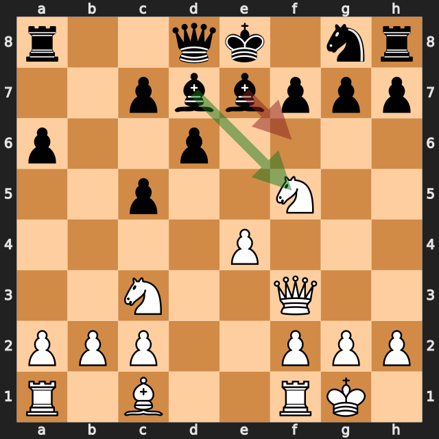

# zbxah vs delegator773

結果: 1-0 / 日付: 2026.10.11

これはStockfishの計算結果に基づく解説下書きです。候補の選定と戦術・戦略の説明はAIアシスタントで仕上げます。

評価値は常に白視点（＋は白有利）。メイトは数値評価と分けて表示します。

「期待スコア」はsf16モデルによる勝ち＋引き分けの半分の推定値で、人間の勝率ではありません。分類は暫定です。

## 注目局面 3...d6

実戦は **d6**。推奨候補は **Nf6** です。

推奨候補の評価: +0.25 / 実戦手を選んだ場合: +0.74。

手番側の期待スコアの低下: 11.6ポイント。

推奨手からの参考変化: Nf6 → O-O → Nxe4 → Re1 → Nd6 → Nxe5

実戦手からの参考変化: d6 → d4 → exd4 → Nxd4 → Bd7 → Nc3

<!-- AIアシスタント: PVと盤面で裏付けられる狙い、相手の応手、改善点を説明する。未検証の戦術名や心理を創作しない。 -->

## 注目局面 6...a6

実戦は **a6**。推奨候補は **Nf6** です。

推奨候補の評価: +0.72 / 実戦手を選んだ場合: +1.10。

手番側の期待スコアの低下: 23.2ポイント。

推奨手からの参考変化: Nf6 → Bxc6 → bxc6 → Qf3 → Bg4 → Qd3

実戦手からの参考変化: a6 → Bxc6 → bxc6 → O-O → c5 → Nf3

<!-- AIアシスタント: PVと盤面で裏付けられる狙い、相手の応手、改善点を説明する。未検証の戦術名や心理を創作しない。 -->

## 注目局面 8...Be7

実戦は **Be7**。推奨候補は **c5** です。

推奨候補の評価: +1.16 / 実戦手を選んだ場合: +1.42。

手番側の期待スコアの低下: 8.6ポイント。

推奨手からの参考変化: c5 → Nf3 → Ne7 → Re1 → Be6 → Ng5

実戦手からの参考変化: Be7 → Qf3

<!-- AIアシスタント: PVと盤面で裏付けられる狙い、相手の応手、改善点を説明する。未検証の戦術名や心理を創作しない。 -->

## 注目局面 9...c5

実戦は **c5**。推奨候補は **Bh4** です。

推奨候補の評価: +1.15 / 実戦手を選んだ場合: +1.47。

手番側の期待スコアの低下: 10.0ポイント。

推奨手からの参考変化: Bh4 → g3 → Bf6 → e5 → Bxe5 → Nxc6

実戦手からの参考変化: c5

<!-- AIアシスタント: PVと盤面で裏付けられる狙い、相手の応手、改善点を説明する。未検証の戦術名や心理を創作しない。 -->

## 注目局面 10...Bf6

実戦は **Bf6**。推奨候補は **Bxf5** です。

推奨候補の評価: +1.47 / 実戦手を選んだ場合: +1.81。

手番側の期待スコアの低下: 2.4ポイント。

推奨手からの参考変化: Bxf5 → exf5 → Rb8 → Re1 → Nf6 → Qe2

実戦手からの参考変化: Bf6 → Nd5

<!-- AIアシスタント: PVと盤面で裏付けられる狙い、相手の応手、改善点を説明する。未検証の戦術名や心理を創作しない。 -->

## 注目局面 11...g6

実戦は **g6**。推奨候補は **Bc6** です。

推奨候補の評価: +2.09 / 実戦手を選んだ場合: +7.95。

手番側の期待スコアの低下: 0.1ポイント。

推奨手からの参考変化: Bc6 → Rd1 → Bxd5 → Rxd5 → Ne7 → e5

実戦手からの参考変化: g6 → Nh6 → Kf8 → Nxg8 → Bg7 → Nh6

<!-- AIアシスタント: PVと盤面で裏付けられる狙い、相手の応手、改善点を説明する。未検証の戦術名や心理を創作しない。 -->
