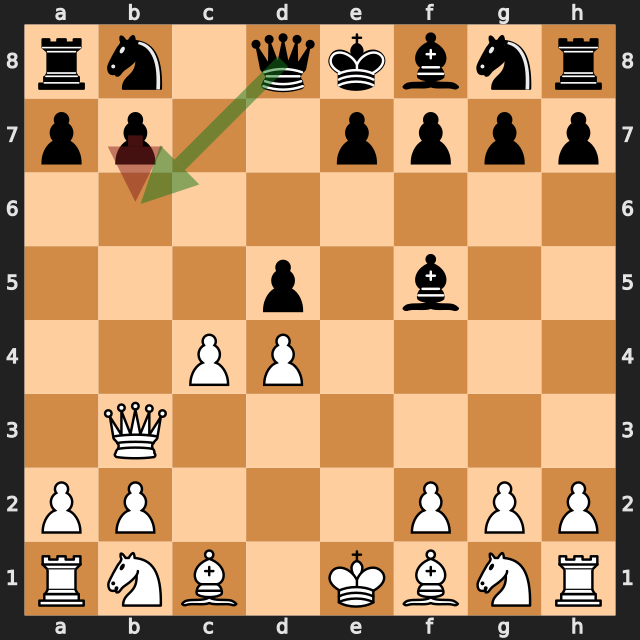
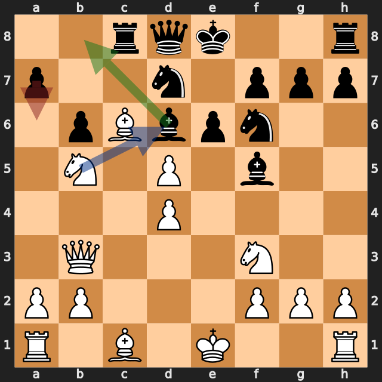
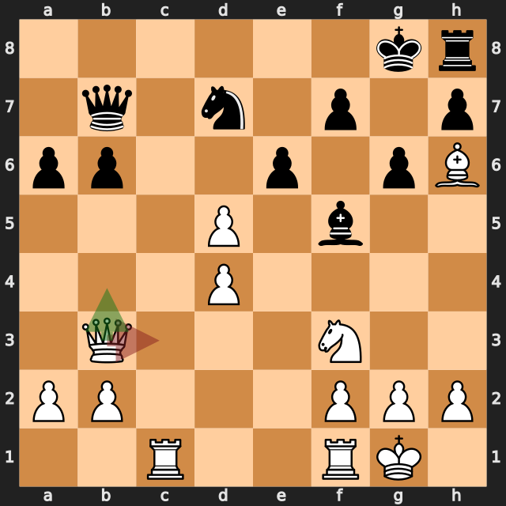

# ナイトの両取りで決まった一局——lichess、白番の振り返り

[棋譜（PGN）](game.pgn) · [全局面の解析](game.analysis.json) · [重要局面の再確認](verification.analysis.json) · [lichessの対局ページ](https://lichess.org/Dw9xDEOX)

2026年10月11日（UTC、日本時間では10月12日）／lichess・レーティング戦（30分＋0秒）／白：筆者（1683）／黒：Rebelhorse（1674）／結果：1–0（18手で黒の投了）

カロ・カン・ディフェンスのパノフ・アタック（**1.e4 c6 2.d4 d5 3.exd5 cxd5 4.c4**）から始まった一局です。白は **5.Qb3** でb7とd5に圧力をかけ、黒の **5...b6?** の後、**6.cxd5** でポーンを得ました。中盤では **11.Nb5** でd6のビショップに当て、黒の **11...a6??** に **12.Nxd6+** の両取りを決めて、18手で黒が投了しました。

以下の評価値はすべて白視点で、プラスが白（筆者）有利です。数値は今回の探索での目安で、確定的な勝率ではありません。局面図は白側から見た向きで、指す前の局面です。赤は実戦手、緑は検討候補、青は相手の狙いを表します。

評価が大きく動いた手を、最善候補との差で並べます（各6秒・MultiPV 4の再確認値）。

| 手 | 指した側 | 最善候補（評価） | 実戦（評価） | 差 |
|---|---|---|---|---|
| **5.Qb3** | 白（筆者） | Qb3（+0.91） | 同じ | 0 |
| 5...b6 | 黒 | Qb6（+0.85） | b6（+2.84） | 約2.0 |
| **7.Bb5+** | 白（筆者） | Nf3（+3.75） | Bb5+（+2.91） | **約0.8** |
| **9.Nc3** | 白（筆者） | Ng5（+3.66） | Nc3（+2.45） | **約1.2** |
| **11.Nb5** | 白（筆者） | Nb5（+2.10） | 同じ | 0 |
| 11...a6 | 黒 | Bb8（+2.28） | a6（+9.78） | 約7.5 |
| **18.Qc3** | 白（筆者） | Qb4（白のメイト） | Qc3（+18.39） | — |

## 1. d5のポーンを得た——5.Qb3と5...b6?

**5.Qb3** は最善候補と一致しました（約 **+0.91**）。b3の白クイーンはb7に当たり、c4のポーンはd5に当たっています（python-chessで確認）。

黒の **5...b6?** はb7を守る手ですが、約 **+2.84** に悪化しました。**6.cxd5** の後、c4のポーンがいなくなるので、b3のクイーンの斜めがd5まで通ります。黒が **6...Qxd5** と取り返すと、**7.Qxd5** でクイーンを取られます。黒の最善候補は **5...Qb6**（約 +0.85）で、クイーン交換を申し込む手でした。

実戦は **6.cxd5 e6** で、白がd5のポーンを1つ得たまま進みました。

**今回の良かった点：** クイーンで2か所（b7とd5）に圧力をかけ、相手が片方しか守れない形を作りました。

## 2. 優勢を少しずつ減らした——7.Bb5+と9.Nc3

**7.Bb5+**（約 +2.91）は、最善候補の **7.Nf3**（約 +3.75）より約0.8低い評価でした。**9.Nc3**（約 +2.45）も、最善候補の **9.Ng5**（約 +3.66）より約1.2低くなっています。9.Ng5のナイトは、e6とf7のポーンに当たります（python-chessで確認）。参考変化は **9...Qe7 10.dxe6 fxe6** です。

どちらも大きなミスではありませんが、10手目のあとは約 **+2.0** まで差が縮まりました。

**今回の学び：** 優勢のときは、駒の展開を急ぐ前に、相手の弱いポーン（今回はe6・f7）に当てる手がないかを見る。

## 3. 両取りの準備と、相手の見落とし——11.Nb5と11...a6??

**11.Nb5** は最善候補と一致しています（約 **+2.10**）。b5のナイトはd6のビショップに当たり、d6を守る黒の駒はありません（python-chessで確認）。

黒の最善候補は **11...Bb8**（約 +2.28）で、ビショップを逃がす手でした。実戦の **11...a6??** はナイトに当てる手ですが、約 **+9.78** に悪化しました。**12.Nxd6+** で、d6のナイトはe8のキングにチェックをかけながら、c8のルークにも当たります（python-chessで確認）。

**12...Kf8 13.Nxc8 Qxc8** の後、白はルークとビショップ、黒はナイトとビショップを取り合った形で、駒の点数では白が6点多くなりました（ポーン1、ナイト・ビショップ3、ルーク5、クイーン9で数えて白35、黒29）。

**今回の良かった点：** 守られていない駒（d6のビショップ）にナイトで当て、両取りの形を準備しました。

## 4. メイトがあった最後の一手——18.Qc3

**15.Bh6+** でh6にビショップを置き、黒キングをg8に閉じ込めました。**16.Bxd7**・**17.Rac1** はいずれも最善候補と一致しています。

18手目の最善候補は **18.Qb4** で、エンジンはメイトの評価（エンジン表記 #7）を示しました。**18.Ng5**（#8）、**18.Ne5**（#9）もメイトの評価です。実戦の **18.Qc3** も約 **+18.39** の勝勢で、黒はここで投了しました。

## 次の対局で意識したいこと

- **2か所に同時に圧力をかける。** 5.Qb3でb7とd5を狙い、ポーンを得ました。
- **守られていない駒には、両取りの形で当てる。** 11.Nb5が、12.Nxd6+の両取りにつながりました。
- **優勢のときも、相手の弱いポーンに当てる手を探す。** 7.Nf3や9.Ng5のほうが、評価が高い手でした。

---

解析：Stockfish 19、1スレッド、Hash 128MB。全局面0.3秒、候補12局面を各2秒・MultiPV 3で解析しました。記事で扱った局面（5.Qb3、5...b6、7.Bb5+、9.Nc3、10.Bc6、11.Nb5、11...a6、13.Nxc8、14.O-O、16.Bxd7、17.Rac1、18.Qc3）は、各6秒・MultiPV 4で再確認しています。評価値は本文で明示した探索の値であり、確定的な勝率ではありません。

自動選定の重要局面（6局面：1.e4、1...c6、3.exd5、4.c4、4...Bf5、5...b6）は序盤の手が中心で、11...a6と18.Qc3は入りませんでした。このため、追加解析で確認しています。10.Bc6（最善候補 O-O との差約0.2）、13.Nxc8（最善候補 Bf4 との差約0.3）は差が小さいため、本文では扱っていません。

このPGNにはlichessの評価コメントが付いておらず、数値はすべて本ツールのStockfishで計算しています。
