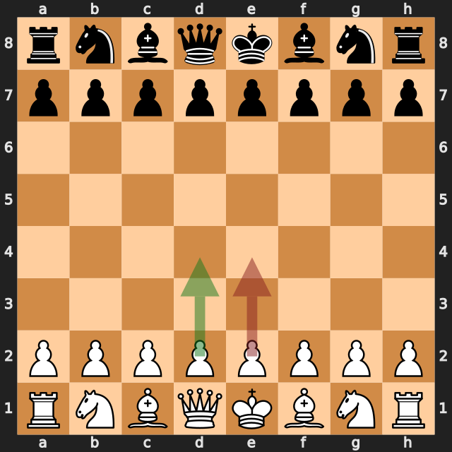
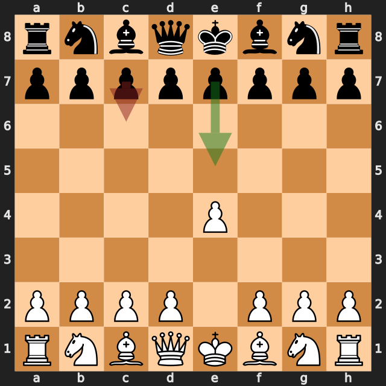
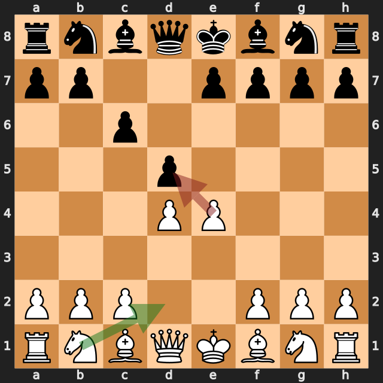
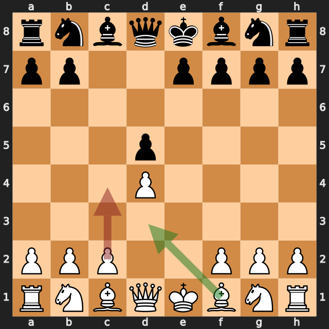
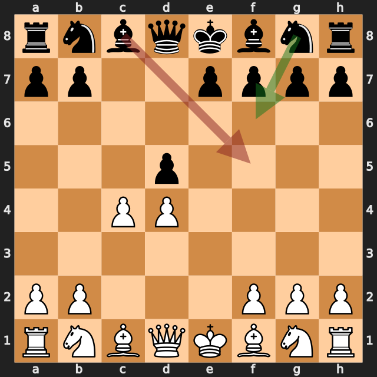

# zbxah vs Rebelhorse

結果: 1-0 / 日付: 2026.10.11

これはStockfishの計算結果に基づく解説下書きです。候補の選定と戦術・戦略の説明はAIアシスタントで仕上げます。

評価値は常に白視点（＋は白有利）。メイトは数値評価と分けて表示します。

「期待スコア」はsf16モデルによる勝ち＋引き分けの半分の推定値で、人間の勝率ではありません。分類は暫定です。

## 注目局面 1.e4

実戦は **e4**。推奨候補は **d4** です。

推奨候補の評価: +0.25 / 実戦手を選んだ場合: +0.24。

手番側の期待スコアの低下: 0.1ポイント。

推奨手からの参考変化: d4 → Nf6 → c4 → e6 → Nc3 → d5

実戦手からの参考変化: e4 → e5 → Nf3 → Nc6 → Bb5 → Nf6

<!-- AIアシスタント: PVと盤面で裏付けられる狙い、相手の応手、改善点を説明する。未検証の戦術名や心理を創作しない。 -->

## 注目局面 1...c6

実戦は **c6**。推奨候補は **e5** です。

推奨候補の評価: +0.29 / 実戦手を選んだ場合: +0.48。

手番側の期待スコアの低下: 2.6ポイント。

推奨手からの参考変化: e5 → Nf3 → Nc6 → Bb5 → Nf6 → O-O

実戦手からの参考変化: c6 → d4 → d5 → e5 → c5 → Nf3

<!-- AIアシスタント: PVと盤面で裏付けられる狙い、相手の応手、改善点を説明する。未検証の戦術名や心理を創作しない。 -->

## 注目局面 3.exd5

実戦は **exd5**。推奨候補は **Nd2** です。

推奨候補の評価: +0.43 / 実戦手を選んだ場合: +0.23。

手番側の期待スコアの低下: 2.1ポイント。

推奨手からの参考変化: Nd2 → dxe4 → Nxe4 → Nf6 → Nxf6+ → exf6

実戦手からの参考変化: exd5 → cxd5

<!-- AIアシスタント: PVと盤面で裏付けられる狙い、相手の応手、改善点を説明する。未検証の戦術名や心理を創作しない。 -->

## 注目局面 4.c4

実戦は **c4**。推奨候補は **Bd3** です。

推奨候補の評価: +0.22 / 実戦手を選んだ場合: +0.20。

手番側の期待スコアの低下: 0.1ポイント。

推奨手からの参考変化: Bd3 → Nc6

実戦手からの参考変化: c4 → Nf6 → Nc3 → Nc6 → Nf3 → Bg4

<!-- AIアシスタント: PVと盤面で裏付けられる狙い、相手の応手、改善点を説明する。未検証の戦術名や心理を創作しない。 -->

## 注目局面 4...Bf5

実戦は **Bf5**。推奨候補は **Nf6** です。

推奨候補の評価: +0.30 / 実戦手を選んだ場合: +0.91。

手番側の期待スコアの低下: 21.1ポイント。

推奨手からの参考変化: Nf6 → Nc3 → e6 → Nf3 → Bb4 → cxd5

実戦手からの参考変化: Bf5 → Qb3

<!-- AIアシスタント: PVと盤面で裏付けられる狙い、相手の応手、改善点を説明する。未検証の戦術名や心理を創作しない。 -->

## 注目局面 5...b6

実戦は **b6**。推奨候補は **Qb6** です。

推奨候補の評価: +0.92 / 実戦手を選んだ場合: +3.03。

手番側の期待スコアの低下: 26.8ポイント。

推奨手からの参考変化: Qb6 → Nc3 → Qxb3 → axb3 → Nc6 → Nf3

実戦手からの参考変化: b6 → cxd5

<!-- AIアシスタント: PVと盤面で裏付けられる狙い、相手の応手、改善点を説明する。未検証の戦術名や心理を創作しない。 -->
