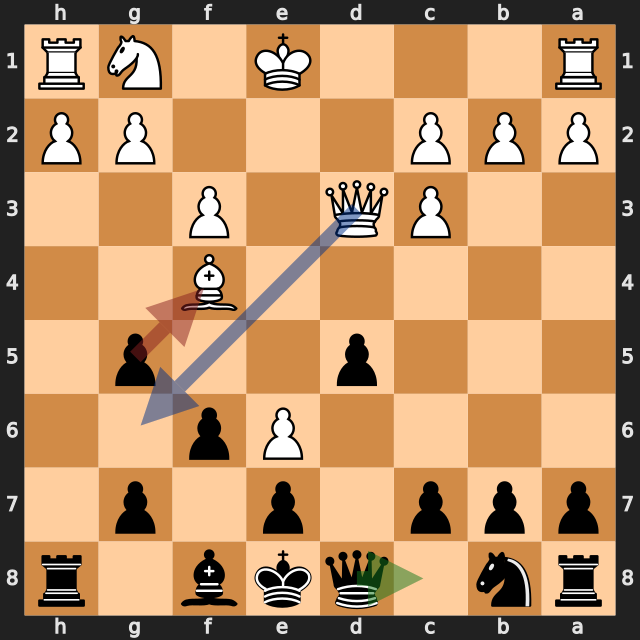

# ビショップを取った直後のメイト——lichess、黒番の振り返り

[棋譜（PGN）](game.pgn) · [全局面の解析](game.analysis.json) · [重要局面の再確認](verification.analysis.json) · [lichessの対局ページ](https://lichess.org/GGJas9la)

2026年10月11日（UTC、日本時間では10月12日）／lichess・レーティング戦（30分＋20秒）／白：ymoh1（1775）／黒：筆者（1688）／結果：1–0（11手で白のチェックメイト）

アレヒン・ディフェンス（lichessの分類は「Scandinavian Variation」）から、11手で終わった短い一局です。黒は **8...f6?** で白のe6のポーンを残し、黒キングの周りが弱くなりました。白の **10.Qd3?** でほぼ互角に戻るチャンスがありましたが、**10...gxf4??** でビショップを取った直後に **11.Qg6#** と詰まされました。

以下の評価値はすべて白視点です。プラスが白有利、マイナスが黒（筆者）有利です。数値は今回の探索での目安で、確定的な勝率ではありません。局面図は黒側から見た向きで、指す前の局面です。赤は実戦手、緑は検討候補、青は相手の狙いを表します。

評価が大きく動いた手を、最善候補との差で並べます（各6秒・MultiPV 4の再確認値）。

| 手 | 指した側 | 最善候補（評価） | 実戦（評価） | 差 |
|---|---|---|---|---|
| 6...Bg6 | 黒（筆者） | Qd7（+0.11） | Bg6（+0.56） | 約0.5 |
| **8...f6** | 黒（筆者） | Qd6（+0.69） | f6（+2.75） | **約2.1** |
| 9.Bf4 | 白 | Qd3（+2.95） | Bf4（+2.18） | 約0.8 |
| 10.Qd3 | 白 | Bg3（+1.86） | Qd3（+0.26） | 約1.6 |
| **10...gxf4** | 黒（筆者） | Qc8（+0.41） | gxf4（白のメイト） | — |

## 1. e6のポーンを残した——8...f6?

**6...Bg6** はビショップの交換を白に任せる手で、最善候補の **6...Qd7**（約 +0.11）と比べて約 **+0.56** でした。**7.Bxg6 hxg6 8.e6** で、白のポーンがe6まで進みます。

このe6のポーンは、d7とf7に当たっています（python-chessで確認）。最善候補は **8...Qd6**（約 **+0.69**）で、参考変化は **9.exf7+ Kxf7** です。白のポーンがf7を取り、黒キングが取り返すので、e6のポーンは盤上から消えます。

実戦の **8...f6?** は約 **+2.75** で、約2.1悪化しました。e6のポーンが残ったまま、e8からh5への斜めが開いています。参考変化は **9.Qd3 Qd6 10.Qxg6+ Kd8** で、白クイーンがg6のポーンをチェックしながら取り、黒キングはd8へ逃げることになります。

**今回の学び：** キングの前に入ってきた相手のポーンは、取り除けるときに取り除く。キングの周りのポーンを動かすときは、新しく開く斜めを確認する。

## 2. ビショップを取ってメイト——10...gxf4??

**9...g5** は最善候補と一致し（約 +2.14）、f4のビショップに当てました。白の最善候補は **10.Bg3**（約 +1.86）でビショップを逃がす手でしたが、実戦の **10.Qd3?** はビショップを取らせる手で、約 **+0.26** とほぼ互角になりました。

ただし、**10.Qd3** にはメイトの狙いがあります。d3のクイーンはg6のマスに当たっており（python-chessで確認）、g6に入るとe8の黒キングにチェックがかかります。

最善候補は **10...Qc8**（約 **+0.41**）です。クイーンがd8から離れるので、**11.Qg6+** には **11...Kd8** と逃げられます。参考変化は **11.Qg6+ Kd8 12.O-O-O Qxe6** で、黒はe6のポーンを取り、ほぼ互角です。**10...Rh6**（約 +1.94）でg6を守る手もありました。

実戦の **10...gxf4??** は、ビショップを取りましたが、**11.Qg6#** でチェックメイトになりました。メイトの局面では、黒キングの逃げ場がすべてふさがっています（python-chessで確認）。

- d7とf7は、e6の白ポーンが当たっている（f7にはg6のクイーンも当たっている）
- d8は自分のクイーン、f8は自分のビショップ、e7は自分のポーンでふさがっている

**今回の学び：** タダで取れる駒があるときほど、相手の次のチェックを確認する。キングの周りが自分の駒でふさがっていると、1回のチェックでメイトになることがある。

## 次の対局で意識したいこと

- **キングの前に入ってきたポーンは、取り除けるときに取り除く。** 8...Qd6なら、9.exf7+ Kxf7でe6のポーンが消えました。
- **駒を取る前に、相手のチェックをすべて確認する。** 10...gxf4??の直後に、11.Qg6#がありました。
- **キングの逃げ場を作っておく。** 10...Qc8なら、d8が空いてメイトを防げました。

---

解析：Stockfish 19、1スレッド、Hash 128MB。全局面0.3秒、候補12局面を各2秒・MultiPV 3で解析しました。記事で扱った局面（6...Bg6、8.e6、8...f6、9.Bf4、9...g5、10.Qd3、10...gxf4）は、各6秒・MultiPV 4で再確認しています。評価値は本文で明示した探索の値であり、確定的な勝率ではありません。

自動選定の重要局面（6局面：1...Nf6、2.Nc3、3...Ne4、8...f6、10.Qd3、10...gxf4）のうち、1...Nf6・2.Nc3・3...Ne4は差が小さいため扱っていません。

このPGNにはlichessの評価コメントが付いておらず、数値はすべて本ツールのStockfishで計算しています。
