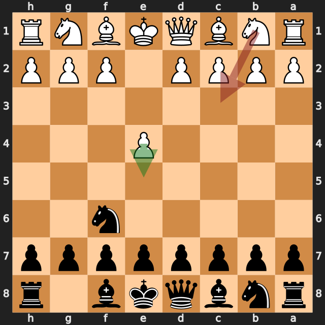
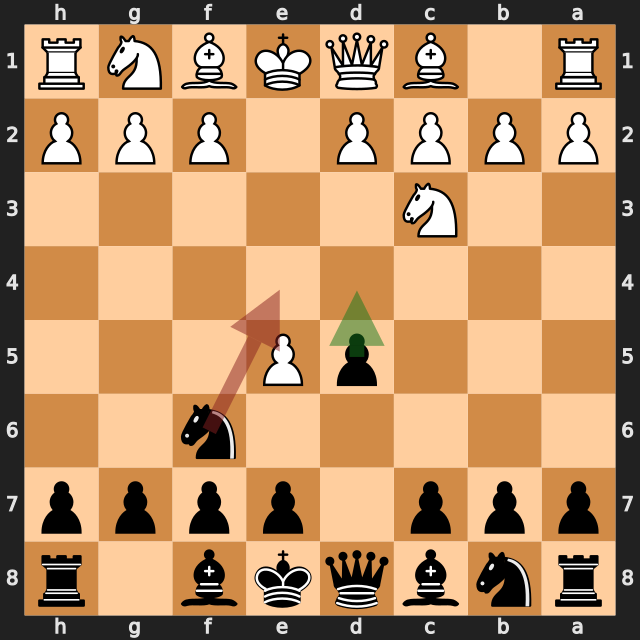
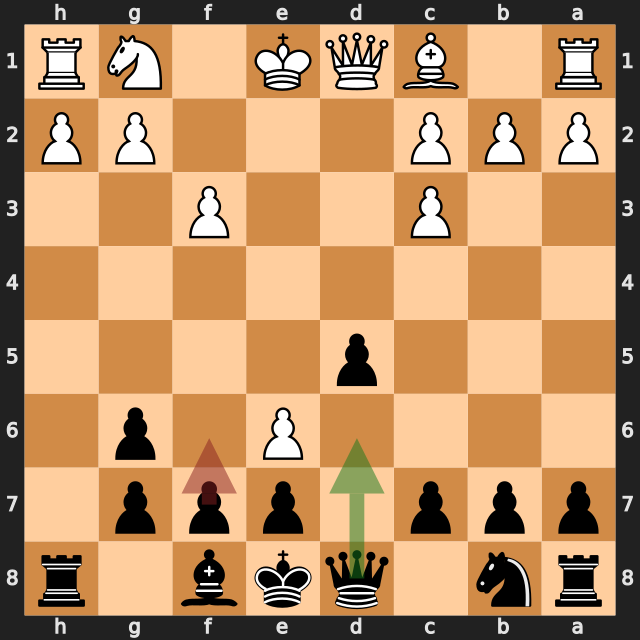
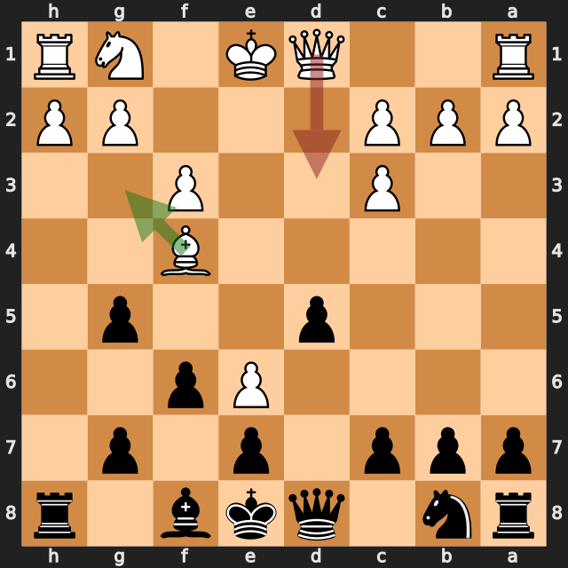
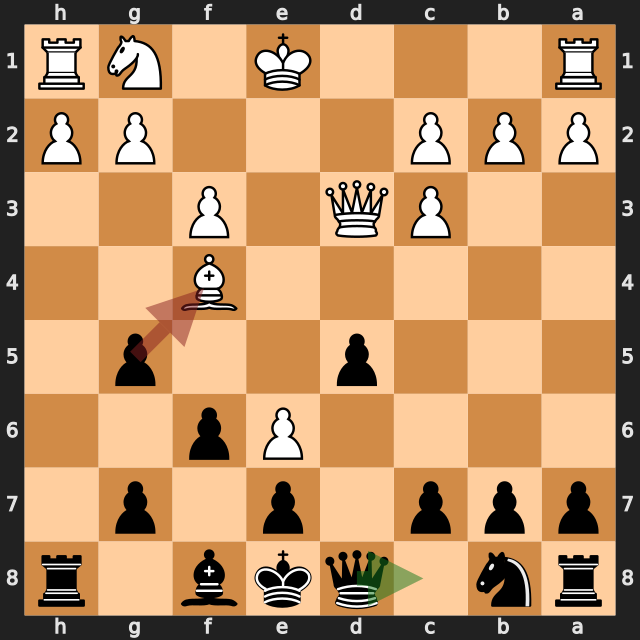

# ymoh1 vs zbxah

結果: 1-0 / 日付: 2026.10.11

これはStockfishの計算結果に基づく解説下書きです。候補の選定と戦術・戦略の説明はAIアシスタントで仕上げます。

評価値は常に白視点（＋は白有利）。メイトは数値評価と分けて表示します。

「期待スコア」はsf16モデルによる勝ち＋引き分けの半分の推定値で、人間の勝率ではありません。分類は暫定です。

## 注目局面 1...Nf6

実戦は **Nf6**。推奨候補は **e5** です。

推奨候補の評価: +0.27 / 実戦手を選んだ場合: +0.77。

手番側の期待スコアの低下: 13.4ポイント。

推奨手からの参考変化: e5 → Nf3

実戦手からの参考変化: Nf6 → e5

<!-- AIアシスタント: PVと盤面で裏付けられる狙い、相手の応手、改善点を説明する。未検証の戦術名や心理を創作しない。 -->

## 注目局面 2.Nc3

実戦は **Nc3**。推奨候補は **e5** です。

推奨候補の評価: +0.76 / 実戦手を選んだ場合: +0.13。

手番側の期待スコアの低下: 13.6ポイント。

推奨手からの参考変化: e5 → Nd5

実戦手からの参考変化: Nc3 → e5 → Nf3 → Nc6 → Bb5 → Nd4

<!-- AIアシスタント: PVと盤面で裏付けられる狙い、相手の応手、改善点を説明する。未検証の戦術名や心理を創作しない。 -->

## 注目局面 3...Ne4

実戦は **Ne4**。推奨候補は **d4** です。

推奨候補の評価: +0.28 / 実戦手を選んだ場合: +0.74。

手番側の期待スコアの低下: 11.4ポイント。

推奨手からの参考変化: d4 → exf6 → dxc3 → fxg7 → cxd2+ → Qxd2

実戦手からの参考変化: Ne4 → Nce2

<!-- AIアシスタント: PVと盤面で裏付けられる狙い、相手の応手、改善点を説明する。未検証の戦術名や心理を創作しない。 -->

## 注目局面 8...f6

実戦は **f6**。推奨候補は **Qd6** です。

推奨候補の評価: +0.62 / 実戦手を選んだ場合: +2.85。

手番側の期待スコアの低下: 42.9ポイント。

第2候補との評価差が大きく、最善候補を見つけることが重要な局面です。唯一手かどうかは追加検証が必要です。

推奨手からの参考変化: Qd6 → exf7+ → Kxf7 → f4 → Nd7 → Nf3

実戦手からの参考変化: f6 → Qd3

<!-- AIアシスタント: PVと盤面で裏付けられる狙い、相手の応手、改善点を説明する。未検証の戦術名や心理を創作しない。 -->

## 注目局面 10.Qd3

実戦は **Qd3**。推奨候補は **Bg3** です。

推奨候補の評価: +1.95 / 実戦手を選んだ場合: +0.70。

手番側の期待スコアの低下: 39.8ポイント。

第2候補との評価差が大きく、最善候補を見つけることが重要な局面です。唯一手かどうかは追加検証が必要です。

推奨手からの参考変化: Bg3 → c6 → Qd3 → Rh6 → Ne2 → Na6

実戦手からの参考変化: Qd3 → Qc8

<!-- AIアシスタント: PVと盤面で裏付けられる狙い、相手の応手、改善点を説明する。未検証の戦術名や心理を創作しない。 -->

## 注目局面 10...gxf4

実戦は **gxf4**。推奨候補は **Qc8** です。

推奨候補の評価: +0.52 / 実戦手を選んだ場合: 白のメイト（エンジン表記 #1）。

手番側の期待スコアの低下: 45.8ポイント。

実戦手の変化では、相手側のメイトが示されています。

第2候補との評価差が大きく、最善候補を見つけることが重要な局面です。唯一手かどうかは追加検証が必要です。

推奨手からの参考変化: Qc8 → Qg6+

実戦手からの参考変化: gxf4 → Qg6#

<!-- AIアシスタント: PVと盤面で裏付けられる狙い、相手の応手、改善点を説明する。未検証の戦術名や心理を創作しない。 -->
